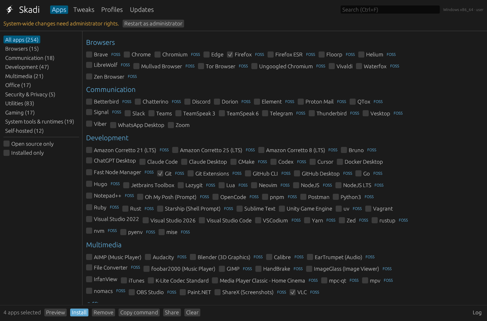
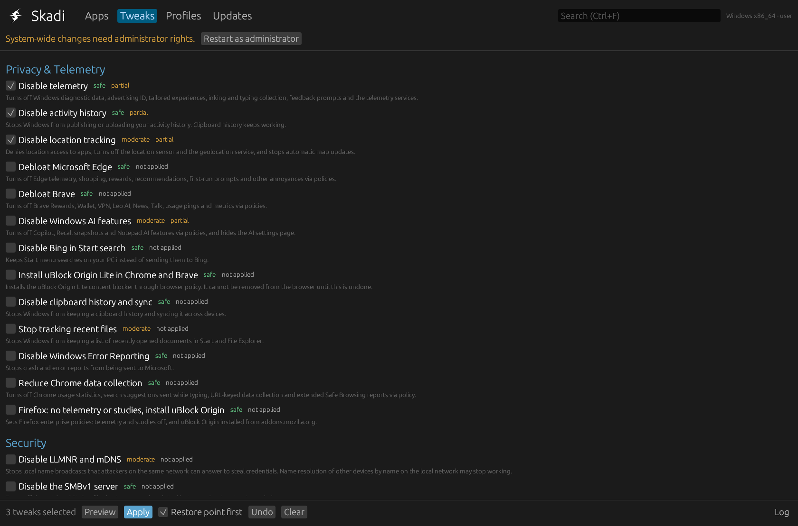
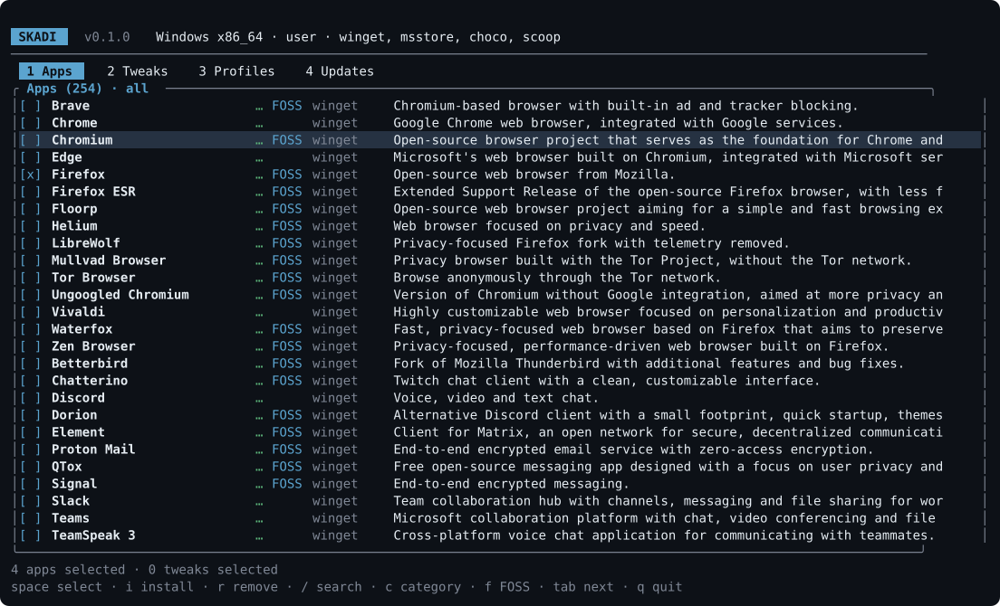
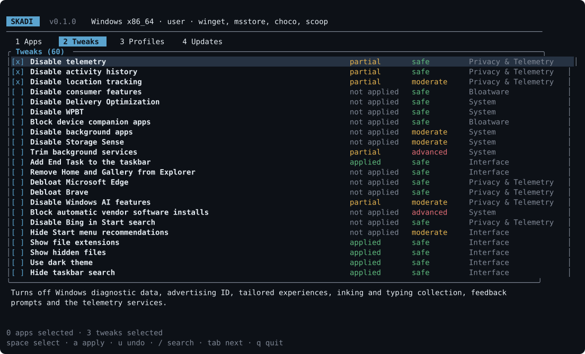

<p align="center">
  <picture>
    <source media="(prefers-color-scheme: dark)" srcset="assets/mark-white-512.png">
    
  </picture>
</p>

<h1 align="center">Skadi</h1>

<p align="center">
  <strong>Install your apps and take back your privacy on Windows, Linux and macOS.</strong><br>
  One small, fast, open-source tool with a graphical and a terminal interface.
</p>

<p align="center">
  <a href="https://github.com/LLCForge/Skadi/actions/workflows/ci.yml"></a>
  <a href="LICENSE"></a>
  <a href="README.tr.md"></a>
</p>

---

Skadi works like Ninite and WinUtil, on every desktop system. Pick the apps you want and Skadi
installs them with the package managers your system already trusts. Then turn off telemetry, ads and
bloat with tweaks that are documented, previewed before they run and can be undone.

**Privacy and security come first.** Skadi has no telemetry, no account and no server of its own. It
never runs commands through a shell, records every command it runs in a local audit log, and every
tweak links to the documentation it is based on.

## Quick start

Run one line; it downloads Skadi, checks its SHA-256 checksum (and its signed build provenance if the
GitHub CLI is installed), runs it and deletes it afterwards. Nothing is installed.

**Windows** (PowerShell):

```powershell
irm https://raw.githubusercontent.com/LLCForge/Skadi/main/install.ps1 | iex
```

**Linux and macOS**:

```bash
curl -fsSL https://raw.githubusercontent.com/LLCForge/Skadi/main/install.sh | sh
```

Pin a release with `SKADI_VERSION=v1.2.3` (or `$env:SKADI_VERSION` on Windows). Read the launcher
first if you like; it is short. Skadi opens the graphical interface when a display is available and
the terminal interface otherwise.

## Screenshots

<p align="center">
  
  
</p>
<p align="center">
  
  
</p>

## What it does

**Apps**
- 256 apps in ten categories, each with an open-source label, telemetry information with its source,
  privacy notes and privacy-friendly alternatives.
- 21 package managers: winget, Microsoft Store, Chocolatey, Scoop, apt, dnf, yum, zypper, pacman,
  AUR helpers, apk, xbps, emerge, eopkg, urpmi, Flatpak, Snap, Nix, Homebrew (formulae and casks)
  and mas. Missing managers are set up on request.
- Updates with pinning, a weekly schedule, notifications and rollback to the previous version;
  presets, profiles you can share, offline bundles and checked AppImages.

**Privacy and debloat**
- 99 tweaks for Windows, Linux and macOS: telemetry, ads, AI features, tracking, bloatware, search
  indexing, browser policies and more. Each one has a risk level, a plain explanation of its side
  effects and a link to its documentation.
- Preview before applying, automatic rollback if something fails, undo at any time, and detection
  when an update turns a setting back.
- Private DNS (DoH, DoT), a hosts block list, proxy and certificate checks, and reports of which
  apps can use your camera, microphone and location.

**Security**
- An audit with a score: disk encryption, Secure Boot, TPM, firewall, accounts, sudo rules, SSH and
  automatic updates.
- Malware scans (Microsoft Defender, ClamAV, rkhunter), firewall control and SSH hardening that
  refuses changes that could lock you out.

**Maintenance**
- Cleanup, startup apps, power plans, disk health and usage, system repair, Wi-Fi profiles,
  dotfiles and bookmarks backups, and a fresh install wizard.

**For teams**
- Export to Ansible, Intune, Nix, Brewfile and winget; apply over SSH; macOS configuration profiles;
  signed profiles, tweak packs, sandboxed plugins and an organisation policy.

## Everyday commands

```bash
skadi install firefox git vlc        # install apps
skadi tweak list --category privacy  # see privacy tweaks and their status
skadi tweak apply --safe --dry-run   # preview the safe tweaks
skadi tweak revert --last            # undo the last tweak session
skadi audit                          # security checks and privacy score
skadi update --check                 # list available updates
skadi setup                          # guided setup for a new computer
```

`skadi --help` lists every command; add `--lang tr` for Turkish.

## Build from source

```bash
cargo build --release
```

Requires Rust 1.94. The binary is in `target/release/`. See [ARCHITECTURE.md](ARCHITECTURE.md) for
how Skadi is put together.

## Documentation

- [Architecture](ARCHITECTURE.md) · [Roadmap](ROADMAP.md) · [Changelog](CHANGELOG.md)
- [Contributing](CONTRIBUTING.md) · [Security policy](SECURITY.md) · [Code of conduct](CODE_OF_CONDUCT.md)
- Guides: [local account](docs/guides/local-account.md) · [disk encryption](docs/guides/disk-encryption.md) ·
  [automatic updates](docs/guides/automatic-updates.md) · [VPN](docs/guides/vpn.md) ·
  [Wi-Fi profiles](docs/guides/wifi-profiles.md) · [macOS privacy](docs/guides/macos-privacy.md)

## License

Skadi is licensed under the [Apache License 2.0](LICENSE). Some Windows tweaks and catalog entries
are adapted from WinUtil (MIT); see [NOTICE](NOTICE).
