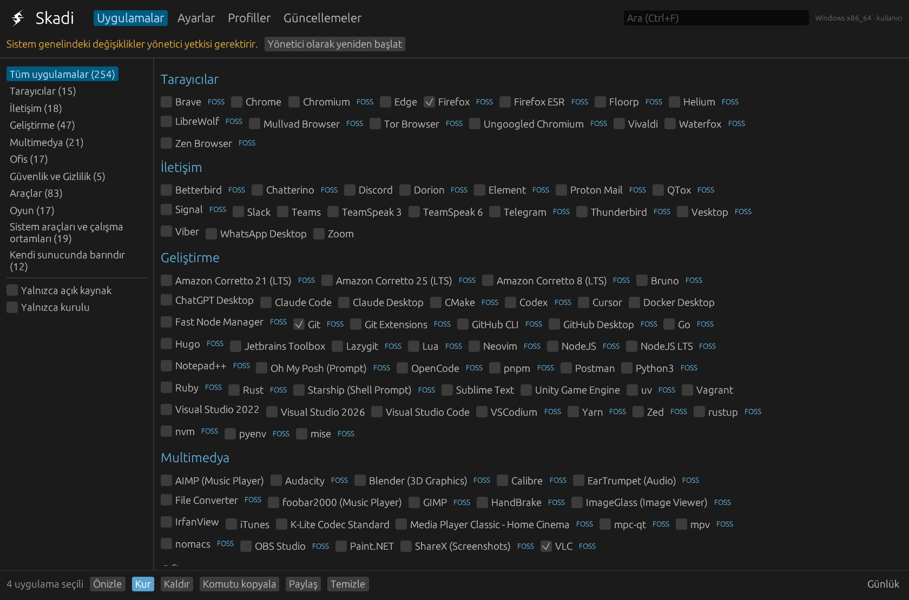
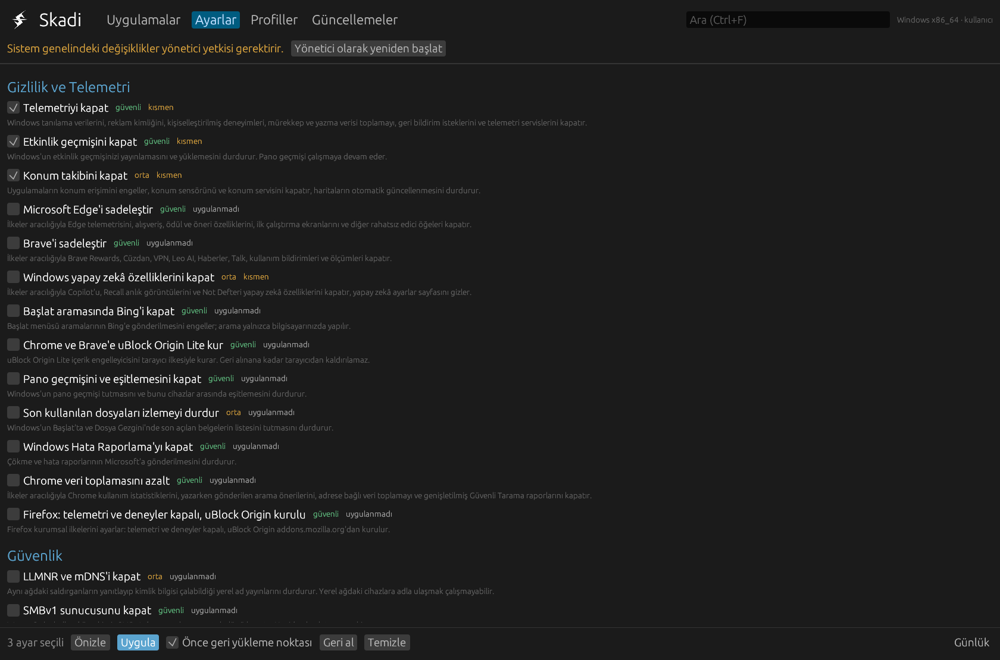
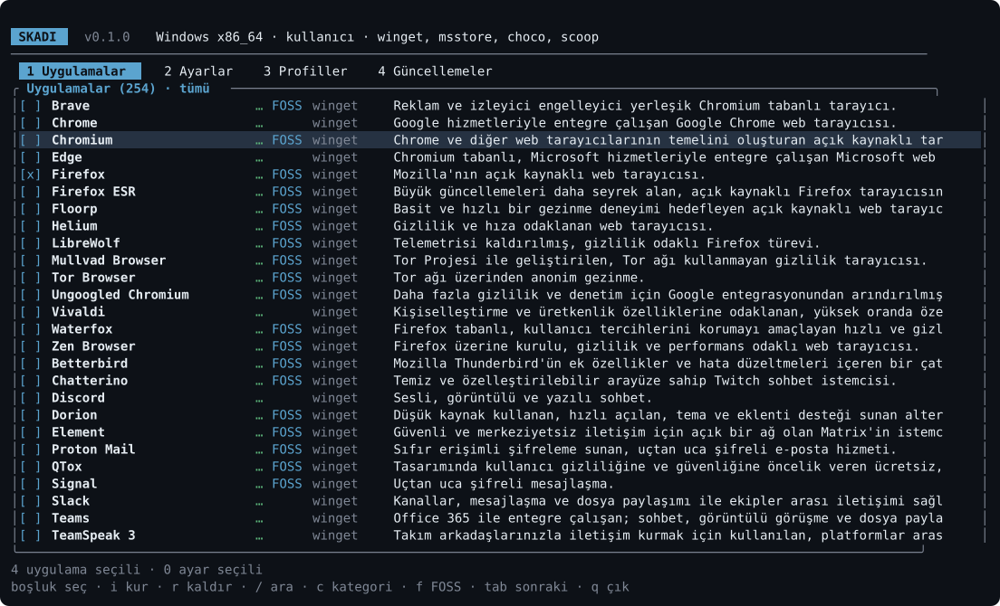
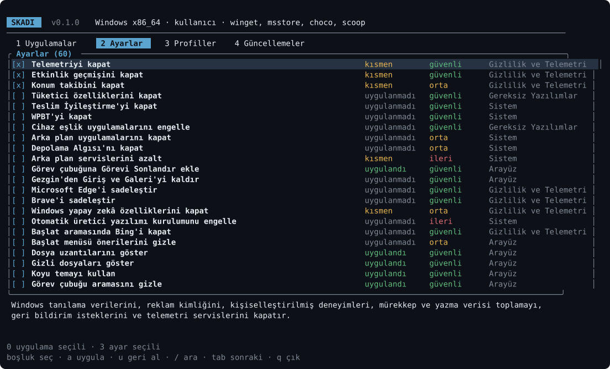

<p align="center">
  <picture>
    <source media="(prefers-color-scheme: dark)" srcset="assets/mark-white-512.png">
    
  </picture>
</p>

<h1 align="center">Skadi</h1>

<p align="center">
  <strong>Windows, Linux ve macOS'ta uygulamalarınızı kurun, gizliliğinizi geri alın.</strong><br>
  Grafik ve terminal arayüzü olan küçük, hızlı ve açık kaynaklı tek bir araç.
</p>

<p align="center">
  <a href="https://github.com/LLCForge/Skadi/actions/workflows/ci.yml"></a>
  <a href="LICENSE"></a>
  <a href="README.md"></a>
</p>

---

Skadi, Ninite ve WinUtil gibi çalışır ama her masaüstü sistemde. İstediğiniz uygulamaları seçin, Skadi
onları sisteminizin zaten güvendiği paket yöneticileriyle kursun. Ardından telemetriyi, reklamları ve
gereksiz yazılımları; belgelenmiş, çalışmadan önce önizlenen ve geri alınabilen ayarlarla kapatın.

**Önceliğimiz gizlilik ve güvenlik.** Skadi'de telemetri, hesap ya da kendine ait bir sunucu yoktur.
Komutları hiçbir zaman kabuk üzerinden çalıştırmaz, çalıştırdığı her komutu yerel bir denetim
günlüğüne yazar ve her ayar dayandığı belgeye bağlantı verir.

## Hızlı başlangıç

Tek bir satır çalıştırın. Skadi'yi indirir, SHA-256 özetini (GitHub CLI kuruluysa imzalı derleme
kanıtını da) doğrular, çalıştırır ve ardından siler. Hiçbir şey kurulmaz.

**Windows** (PowerShell):

```powershell
irm https://raw.githubusercontent.com/LLCForge/Skadi/main/install.ps1 | iex
```

**Linux ve macOS**:

```bash
curl -fsSL https://raw.githubusercontent.com/LLCForge/Skadi/main/install.sh | sh
```

Belirli bir sürüm için `SKADI_VERSION=v1.2.3` (Windows'ta `$env:SKADI_VERSION`) kullanın. İsterseniz
önce başlatıcıyı okuyun; kısadır. Ekran varsa grafik arayüz, yoksa terminal arayüzü açılır.

## Ekran görüntüleri

<p align="center">
  
  
</p>
<p align="center">
  
  
</p>

## Neler yapar

**Uygulamalar**
- On kategoride 256 uygulama. Her birinde açık kaynak etiketi, kaynağıyla birlikte telemetri bilgisi,
  gizlilik notları ve gizlilik dostu alternatifler.
- 21 paket yöneticisi: winget, Microsoft Store, Chocolatey, Scoop, apt, dnf, yum, zypper, pacman,
  AUR yardımcıları, apk, xbps, emerge, eopkg, urpmi, Flatpak, Snap, Nix, Homebrew (formül ve cask)
  ve mas. Eksik yöneticiler istek üzerine kurulur.
- Sabitleme, haftalık zamanlama, bildirim ve önceki sürüme geri dönme ile güncellemeler; hazır
  setler, paylaşılabilir profiller, çevrimdışı paketler ve doğrulanmış AppImage'lar.

**Gizlilik ve sadeleştirme**
- Windows, Linux ve macOS için 99 ayar: telemetri, reklamlar, yapay zekâ özellikleri, izleme,
  gereksiz yazılımlar, arama dizinleme, tarayıcı ilkeleri ve daha fazlası. Her birinin risk seviyesi,
  yan etkilerinin sade bir açıklaması ve belgesine bağlantısı vardır.
- Uygulamadan önce önizleme, bir şey ters giderse otomatik geri alma, istediğiniz an geri dönme ve
  bir güncelleme ayarı geri çevirdiğinde bunu fark etme.
- Şifreli DNS (DoH, DoT), hosts engel listesi, proxy ve sertifika denetimleri; kameranıza,
  mikrofonunuza ve konumunuza hangi uygulamaların erişebildiğine dair raporlar.

**Güvenlik**
- Puanlı bir denetim: disk şifreleme, Güvenli Önyükleme, TPM, güvenlik duvarı, hesaplar, sudo
  kuralları, SSH ve otomatik güncellemeler.
- Zararlı yazılım taraması (Microsoft Defender, ClamAV, rkhunter), güvenlik duvarı denetimi ve sizi
  dışarıda bırakabilecek değişiklikleri reddeden SSH sertleştirmesi.

**Bakım**
- Temizlik, açılış uygulamaları, güç planları, disk sağlığı ve kullanımı, sistem onarımı, Wi-Fi
  profilleri, dotfiles ve yer imi yedekleri ve yeni bilgisayar için kurulum sihirbazı.

**Ekipler için**
- Ansible, Intune, Nix, Brewfile ve winget'e dışa aktarma; SSH ile uygulama; macOS yapılandırma
  profilleri; imzalı profiller, tweak paketleri, korumalı eklentiler ve kurum politikası.

## Günlük komutlar

```bash
skadi install firefox git vlc        # uygulama kur
skadi tweak list --category privacy  # gizlilik ayarlarını ve durumlarını gör
skadi tweak apply --safe --dry-run   # güvenli ayarları önizle
skadi tweak revert --last            # son ayar oturumunu geri al
skadi audit                          # güvenlik denetimi ve gizlilik puanı
skadi update --check                 # mevcut güncellemeleri listele
skadi setup                          # yeni bilgisayar için rehberli kurulum
```

`skadi --help` tüm komutları listeler; dil seçmek için `--lang tr` ya da `--lang en` ekleyin.

## Kaynaktan derleme

```bash
cargo build --release
```

Rust 1.94 gerekir. Program `target/release/` klasöründe oluşur. Skadi'nin nasıl kurulduğu için
[ARCHITECTURE.md](ARCHITECTURE.md) dosyasına bakın.

## Belgeler

- [Mimari](ARCHITECTURE.md) · [Yol haritası](ROADMAP.md) · [Değişiklik günlüğü](CHANGELOG.md)
- [Katkı rehberi](CONTRIBUTING.md) · [Güvenlik politikası](SECURITY.md) · [Davranış kuralları](CODE_OF_CONDUCT.md)
- Rehberler: [yerel hesap](docs/guides/local-account.tr.md) · [disk şifreleme](docs/guides/disk-encryption.tr.md) ·
  [otomatik güncellemeler](docs/guides/automatic-updates.tr.md) · [VPN](docs/guides/vpn.tr.md) ·
  [Wi-Fi profilleri](docs/guides/wifi-profiles.tr.md) · [macOS gizliliği](docs/guides/macos-privacy.tr.md)

## Lisans

Skadi [Apache Lisansı 2.0](LICENSE) ile lisanslanmıştır. Bazı Windows ayarları ve katalog kayıtları
WinUtil'den (MIT) uyarlanmıştır; ayrıntılar için [NOTICE](NOTICE) dosyasına bakın.
